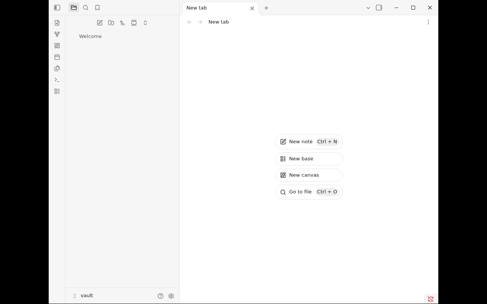

# Obsidian for YunoHost

[](https://install-app.yunohost.org/?app=obsidian)

*[Lire ce readme en français.](./README_fr.md)*

> Obsidian is a Markdown note-taking app: notes stay plain files in a vault you own,
> linked with `[[wiki links]]` and extended by community plugins and themes.

This package runs the Obsidian desktop app on the server and streams the session
into your browser, so the vault is reachable from any device without installing
Obsidian on it.

## Features

- Notes as plain Markdown files, kept in `/home/yunohost.app/obsidian/vault`
- Wiki links, graph view, community plugins and themes
- Browser session behind the YunoHost portal — no separate password to manage
- Clipboard sync both ways, and drag-and-drop uploads into the vault
- Desktop size follows your browser window; the configured size is the starting point
- Hardware video encoding when the server exposes a GPU

## Screenshots



## Installation

```bash
yunohost app install obsidian
```

The install form asks for the domain, an optional subpath, the starting desktop
size and who may reach it. A vault is personal data — restrict the permission to
a group if the notes are not for every account on the server.

## Documentation

- [Admin notes](./doc/ADMIN.md)
- Upstream: <https://obsidian.md/>

## License

The packaging is GPL-3.0. Obsidian itself is proprietary software distributed by
Dynalist Inc.; this package only downloads the official upstream release.
