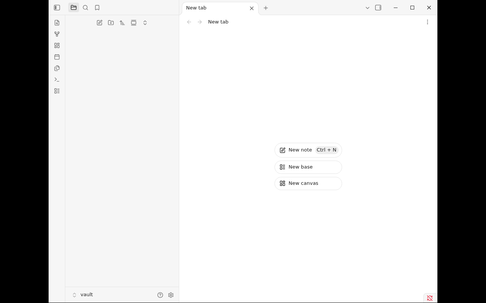

# Obsidian pour YunoHost

[](https://install-app.yunohost.org/?app=obsidian)

*[Read this readme in english.](./README.md)*

> Obsidian est une application de prise de notes Markdown : les notes restent des
> fichiers simples dans un coffre qui vous appartient, reliées par des `[[liens wiki]]`
> et enrichies par des greffons et des thèmes communautaires.

Ce paquet exécute l'application de bureau Obsidian sur le serveur et diffuse la
session dans le navigateur via noVNC : le coffre est accessible depuis n'importe
quel appareil.

## Fonctionnalités

- Notes en fichiers Markdown simples, conservées dans `/home/yunohost.app/obsidian/`
- Liens wiki, vue graphe, greffons et thèmes communautaires
- Accès navigateur derrière le portail YunoHost, avec un mot de passe VNC en second verrou
- Accélération GPU en option pour les serveurs Intel, AMD et NVIDIA

## Captures d'écran



## Installation

```bash
yunohost app install obsidian
```

Le formulaire demande le domaine et, en option, le constructeur du GPU à exposer.
Choisissez `none` pour un rendu logiciel.

## Documentation

- [Notes pour l'administration](./doc/ADMIN_fr.md)
- Amont : <https://obsidian.md/>

## Licence

L'empaquetage est en GPL-3.0. Obsidian lui-même est un logiciel propriétaire
distribué par Dynalist Inc. ; ce paquet se contente de télécharger la version
officielle amont.
